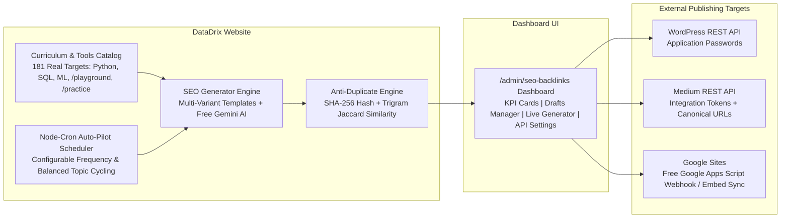

# LearnForge & DataDrix (Full-Stack MERN Platform)

*Learn. Build. Master. Scale.*

A modern, high-performance learning management and developer practice platform built on the **MERN stack** (MongoDB, Express, React 19, Node.js) with Vite. Featuring an interactive curriculum, algorithmic coding challenges, technical interview preparation, and a built-in **Automated SEO Backlink Blog & Multi-Platform Publishing Engine**.

- 🌐 **Live Production App:** [https://learnforge-learning-platform.onrender.com/](https://learnforge-learning-platform.onrender.com/)
- 🔗 **SEO Backlink Engine:** [https://learnforge-learning-platform.onrender.com/admin/seo-backlinks](https://learnforge-learning-platform.onrender.com/admin/seo-backlinks)
- 🐙 **GitHub Repository:** [https://github.com/NITINCHANDER007/learnforge-learning-platform](https://github.com/NITINCHANDER007/learnforge-learning-platform)

---

## 🌟 What's Inside the Platform

### 1. 🚀 14 Tech Paths & 166 Interactive Lessons
Structured, distraction-free markdown curricula with syntax-highlighted code blocks, progress tracking, and certificate generation:
- **Programming & Scripting:** Python, Modern JavaScript (ES6+), HTML5, CSS3, File Handling
- **Databases & Backends:** SQL & Relational Databases, Flask Framework
- **Data Science & AI:** Machine Learning, Pandas, NumPy, Data Visualization
- **Analytics & BI:** Power BI & DAX, Advanced Excel Formulas, Web Scraping Automation

### 2. ⚡ In-Browser Code Playground (`/playground`)
- Real-time client-side code execution in Python (via Pyodide WebAssembly) and JavaScript.
- Zero server compute overhead and safe sandbox execution.

### 3. 🎯 Coding Practice Lab (`/practice`)
- Algorithmic problems with real-time test case evaluation, complexity metrics ($O(N)$ / $O(1)$), and solution editorials.

### 4. 💼 Technical Interview Preparation Corner (`/interview-prep`)
- Curated questions covering CS fundamentals: DBMS & SQL, Operating Systems, OOPs & SOLID principles, System Design, and Python Internals.

---

## 🤖 Automated SEO Backlink Blog System (`/admin/seo-backlinks`)

A dedicated SEO automation suite designed to generate high-ranking technical articles, inject contextual backlinks into your curricula, protect against duplicate content penalties, and publish across multiple external platforms via official APIs.



### Key Features of the SEO Engine:

- **Organic Contextual Backlink Injection:**
  - Dynamically extracts 181 real target URLs from your live curriculum modules and interactive tools.
  - Generates conversational, high-authority anchor texts with verified `dofollow` and canonical links.
- **Anti-Duplicate Content Protection:**
  - **SHA-256 Fingerprinting:** Normalizes text and computes a unique cryptographic hash for every post.
  - **N-Gram Jaccard Similarity:** Compares 3-gram shingles against all existing posts in MongoDB. If similarity exceeds 75%, it automatically rotates structure and code samples.
  - **Canonical URL Enforcement:** Prevents search engine indexing penalties across cross-posted platforms.
- **Dual Free Generation Engines:**
  - **Smart Algorithmic Multi-Variant Engine (Default):** Zero cost, offline-ready, requires no third-party API keys.
  - **Google Gemini AI Engine (Optional):** Supports Google AI Studio's free tier (`gemini-1.5-flash` or `gemini-2.0-flash`) for nuanced, technical long-form content.
- **Multi-Platform Publishing Integrations:**
  - **WordPress:** Native REST API (`/wp-json/wp/v2/posts`) with Application Passwords.
  - **Medium:** Official REST API (`POST /v1/users/{authorId}/posts`) with Integration Tokens, respecting the 5-tag limit and canonical URLs.
  - **Google Sites:** Free Google Apps Script Webhook integration with a 1-click script template deployable to Google Drive.
- **Automated Background Auto-Pilot:**
  - In-process `node-cron` background scheduler running every 6h, 12h, 24h, 48h, or weekly.
  - Automatically identifies under-represented curriculum subjects to maintain a balanced backlink distribution.
  - Full audit trail logging for all automated actions.

---

## 🛠️ Technology Stack (MERN)

| Component | Technology | Description |
|---|---|---|
| **Frontend** | React 19 + Vite | Fast client running on Port 3000 with instant HMR |
| **Backend API** | Node.js + Express 4 | High-throughput REST API with JWT authentication |
| **Database** | MongoDB + Mongoose 8 | Document database storing users, progress, notes, and SEO posts |
| **SEO Engines** | Smart Templates + Gemini AI | Multi-variant generator and Google AI Studio integration |
| **Scheduler** | node-cron | Lightweight, in-process automated task scheduling |
| **Markdown Compiler**| marked + highlight.js | Generates syntax-highlighted HTML from technical markdown |
| **Code Runner** | Pyodide WebAssembly | In-browser Python runtime with zero server execution overhead |
| **Deployment** | Render (`render.yaml`) | Unified single-port full-stack cloud hosting |

---

## 📁 Directory Structure

```
learning-platform/
├── client/                     React 19 + Vite Frontend (Runs on Port 3000)
│   ├── src/
│   │   ├── components/         Navbar, Footer, SearchModal, CustomCursor
│   │   ├── context/            AuthContext, ThemeContext
│   │   ├── pages/              Home, Lesson, Practice, ProblemSolver, SeoDashboard, Admin, etc.
│   │   └── services/           api.js (Client API wrapper)
│   └── vite.config.js          Vite configuration with /api proxy
├── server/                     Node.js + Express API Backend
│   ├── config/                 MongoDB connection (db.js)
│   ├── middleware/             JWT auth, role protection, uploads
│   ├── models/                 User, Progress, Bookmark, Note, BlogPost, SeoSettings
│   ├── routes/                 auth, content, dashboard, admin, compiler, seo
│   ├── services/               seoGeneratorService, publisherService, autoPilotService, contentLoader
│   ├── scripts/                seed.js, testSeo.js, clean-dummy-users.js
│   └── server.js               Unified Express server entry point
├── content/                    14 subjects, 166 lessons in Markdown + JSON
├── uploads/                    Uploaded attachments and user assets
├── package.json                Root orchestration scripts
└── render.yaml                 Render cloud deployment blueprint
```

---

## 🚀 Quick Start Guide

### 1. Install Dependencies

```bash
# Install root, backend, and frontend dependencies
npm install
npm --prefix server install
npm --prefix client install
```

### 2. Configure Environment

Create `server/.env` (or copy from `.env.example`):

```ini
PORT=5000
MONGODB_URI=mongodb://127.0.0.1:27017/datadrix
JWT_SECRET=datadrix-super-secret-jwt-key-2026-secure
CONTENT_DIR=../content
UPLOADS_DIR=../uploads
CLIENT_URL=http://localhost:3000
```

### 3. Seed Default Admin User

```bash
npm run seed
```

**Default Admin Credentials:**
- **Email:** `admin@datadrix.com`
- **Password:** `adminpassword123`

### 4. Run Development Server

```bash
npm run dev
```

- **Frontend:** [http://localhost:3000](http://localhost:3000)
- **Backend API:** [http://localhost:5000/api](http://localhost:5000/api) (Proxied automatically via Vite)
- **SEO Dashboard:** [http://localhost:3000/admin/seo-backlinks](http://localhost:3000/admin/seo-backlinks)

---

## ☁️ Cloud Deployment on Render

This project is configured for 1-click cloud deployment via [render.yaml](render.yaml):

1. **Push your code to GitHub:**
   ```bash
   git add -A
   git commit -m "feat: complete MERN platform with SEO publisher"
   git push origin main
   ```
2. **Link to Render:**
   - In [Render Dashboard](https://dashboard.render.com/), create a new **Web Service** connected to your repository.
   - Or deploy using **Blueprints** with `render.yaml`.
3. **Set Cloud Database:**
   - In your Render service's **Environment** tab, set:
     ```text
     MONGODB_URI = mongodb+srv://<user>:<password>@cluster.mongodb.net/datadrix?retryWrites=true&w=majority
     ```
4. **Live URLs:**
   - **Main Web App:** `https://learnforge-learning-platform.onrender.com/`
   - **SEO Backlinks Portal:** `https://learnforge-learning-platform.onrender.com/admin/seo-backlinks`

---

## 📄 License

MIT License. Designed and maintained for **DataDrix** & **LearnForge Academy**.
